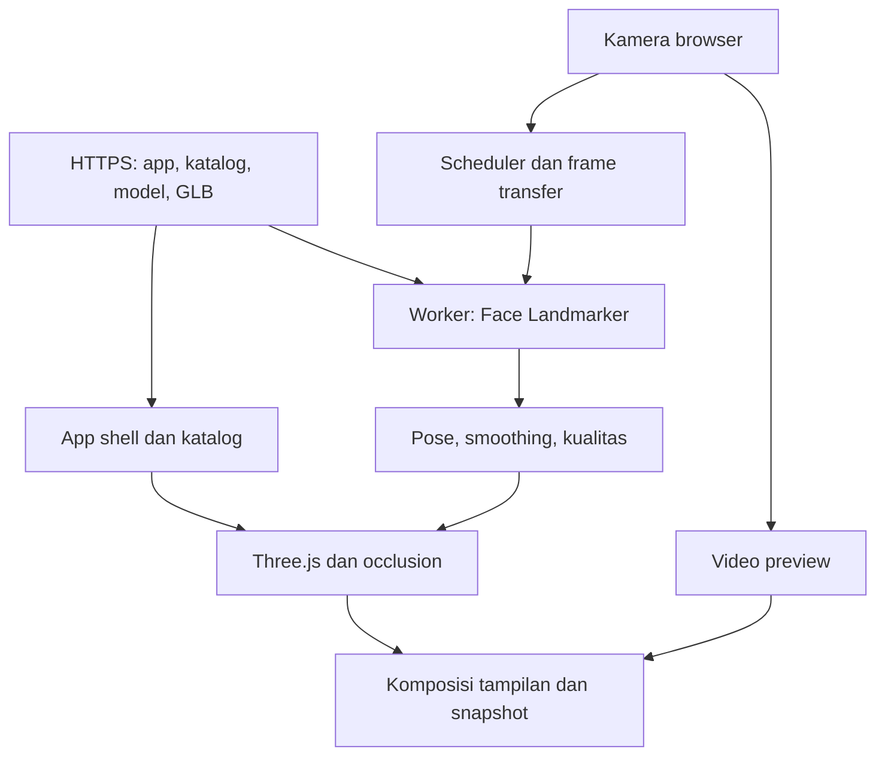

# Virtual Try-On Kacamata — Technical Plan MVP (SDK-first)

Versi 1.2 • 13 Oktober 2026 • Browser SDK • Contoh Vanilla / Asset Studio

Status: arah produk diperbarui pada 11 Oktober 2026 menjadi SDK JavaScript/TypeScript browser-first. Pada 12 Oktober, tahap awal port shader tangkai dari VTOGlasses ditambahkan ke renderer r176; bukti dan acceptance terbuka dicatat di `IMPLEMENTATION_PLAN.md` serta `docs/VTOGLASSES_MIGRATION.md`. Acceptance kamera/perangkat dan benchmark belum terbukti. Semua angka performa, budget aset, dan durasi di bawah adalah target engineering awal, bukan hasil pengukuran.

## 1. Keputusan dan batas scope

Bangun SDK JavaScript/TypeScript untuk browser sebagai produk utama. SDK menyediakan API publik tanpa ketergantungan React/framework UI; integrasi kamera, worker MediaPipe Tasks Vision Face Landmarker, fitting kacamata, serta rendering Three.js/GLB berada di paket SDK. `examples/vanilla` adalah contoh implementasi. Web/PWA, bila dibuat kelak, juga hanya contoh/konsumen SDK. Distribusikan SDK, WASM, model ML, dan aset GLB lewat HTTPS dengan URL berversi. Katalog dapat dipisahkan menjadi API tanpa mengubah engine. Backend, database, login, pembayaran, dan CMS belum diperlukan untuk alur ini. Self-service publikasi lintas merchant memerlukan backend pada tahap berikutnya.

Mengapa: jalur kamera → tracking → rendering tetap lokal, biaya operasional awal kecil, dan katalog dapat dipisahkan menjadi API tanpa mengubah engine tracking. PWA memberi instalasi dan cache, tetapi tidak meningkatkan kemampuan AR kamera browser dengan sendirinya.

Scope MVP:

- Satu wajah dominan, kamera depan, satu kacamata aktif.
- Lima SKU dengan aset GLB yang dikalibrasi; satu aset referensi tersedia pada minggu pertama.
- Generator aset parametrik merupakan modul opsional SDK. Asset Studio mengonsumsi modul itu melalui alur deskripsi → buat → coba/unduh. Hasil template berstatus approximation sampai diperiksa terhadap produk asli.
- Memulai/menghentikan kamera, memilih produk, petunjuk posisi, pengaturan ukuran visual terbatas, reset, snapshot lokal, dan download.
- Occlusion dasar wajah untuk menyembunyikan bagian kacamata di belakang kepala/wajah; rambut dan tangan tidak menjadi target.
- PWA dapat dipasang pada browser yang mendukung; penggunaan offline hanya setelah seluruh resource yang diperlukan berhasil tersimpan.
- Pemrosesan wajah lokal; tidak mengirim frame, landmark, pose, atau snapshot ke server.

Ditunda: rekomendasi ukuran medis/optik, pengukuran PD, virtual lens prescription, akun, checkout, multi-face, rekaman video, share ke layanan eksternal, CMS, segmentasi rambut/tangan, tas dan baju.

Ukuran pada katalog adalah ukuran produk sebenarnya. Ukuran wajah dari kamera tidak dianggap sebagai pengukuran fisik terverifikasi. Tampilkan pesan: “Pratinjau tampilan; ukuran dan kesesuaian fisik perlu diperiksa.” Pengaturan skala pengguna diberi label “ukuran tampilan”, bukan ukuran wajah.

Asumsi resource: dua engineer frontend/graphics, QA paruh waktu, serta 3D artist paruh waktu. Core try-on diperkirakan 6–8 minggu; scope terintegrasi dengan Asset Studio dasar menjadi 8–10 minggu. Photo-assisted dan backend merchant belum termasuk. Solo core sekitar 10–14 minggu, ditambah sekitar 3–5 minggu untuk Studio dasar, belum termasuk pengadaan/modeling aset. Estimasi diperbarui setelah spike dan usability test.

## 2. Arsitektur runtime



### Pemisahan tanggung jawab

| Bagian | Tanggung jawab | Batas penting |
|---|---|---|
| SDK main thread | Video element, scheduler, Three.js, capture, typed events | SDK framework-agnostic; event landmark/frame tidak menjadi state UI |
| Contoh integrasi | Vanilla JS (pertama); framework lain dapat mengonsumsi SDK | Contoh UI bukan dependensi runtime SDK |
| Dedicated worker | Inisialisasi model, inferensi VIDEO, output tracking | Bukan service worker; tidak mengakses DOM |
| Service worker | Cache app shell dan resource versi tertentu | Tidak menjalankan tracking; tidak cache data kamera |
| Hosting/CDN | Static delivery, HTTPS, compression, cache headers | MVP tidak memiliki endpoint upload wajah |
| CI | Validasi katalog/aset, tests, build, scan, deployment | Deployment production memakai artefak build yang lolos gate |

### Alur per frame

1. Pengguna menekan “Mulai kamera”; aplikasi meminta `getUserMedia({audio:false, video:{facingMode:'user', width:{ideal:1280}, height:{ideal:720}, frameRate:{ideal:30}}})`. Constraint ideal boleh dinegosiasi browser. Video memakai `muted` dan `playsInline`; tunggu metadata dan video berjalan.
2. Scheduler memakai `requestVideoFrameCallback` jika tersedia. Fallback memakai `requestAnimationFrame` dengan pemeriksaan `video.currentTime`, sehingga frame yang sama tidak diinferensi berulang.
3. Saat target interval inferensi tercapai dan worker idle, buat ImageBitmap pada resolusi inference yang ditentukan, lalu transfer ownership ke worker. Maksimal satu frame in-flight. Bila sibuk, lewati frame baru, jangan membuat antrean.
4. Input tidak di-mirror. Sertakan `frameId`, `sessionId`, `timestampMs` monotonik dari satu clock scheduler, dimensi input, serta `performance.now()` dispatch untuk telemetry lokal.
5. Worker memanggil `detectForVideo`, memvalidasi bentuk hasil dan menutup ImageBitmap dalam `finally`. Output berupa landmarks, matriks opsional, timestamp, serta status face present. Profil GPU/CPU diuji, tidak diasumsikan selalu tersedia.
6. Main thread menolak hasil dari session lama, timestamp mundur, atau hasil terlalu tua. Pose solver menghasilkan transform yang sudah konsisten terhadap viewport dan aset. Filtering terpisah untuk translation, rotation, dan scale.
7. Renderer berjalan pada loop sendiri dan mengambil pose terbaru. Interpolasi transform dibatasi; jangan extrapolate lama ketika wajah hilang. Konsumen SDK hanya diberi perubahan status/product yang relevan, tidak update landmark/frame pada setiap inferensi.
8. Mirroring diterapkan sekali pada lapisan komposisi preview yang mencakup video dan overlay. Snapshot menerapkan keputusan mirror yang sama secara eksplisit di canvas, sebab CSS transform tidak ikut `drawImage`.

### Model, fallback, dan compatibility

Konfigurasi awal: `runningMode:'VIDEO'`, `numFaces:1`, `outputFacialTransformationMatrixes:true`, `outputFaceBlendshapes:false`; threshold detection/presence/tracking 0.5 sebagai titik awal, kemudian dituning berdasarkan dataset uji. API tidak diasumsikan menyediakan confidence per frame; kualitas tambahan dihitung dari validitas landmark, konsistensi pose, ukuran wajah, umur hasil, dan residual alignment.

Capability check: secure context, mediaDevices, WebGL2, Worker, ImageBitmap transfer, model/WASM load, serta renderer context creation. `requestVideoFrameCallback`, GPU delegate, dan instalasi PWA adalah kemampuan opsional. Kegagalan GPU delegate mencoba CPU di worker dengan profil lebih rendah. Jika jalur worker/input tidak kompatibel, tampilkan katalog dan pesan dukungan perangkat; fallback main-thread hanya boleh masuk production setelah spike terpisah membuktikan UI responsif. Jangan menjanjikan semua browser mendukung AR.

Batas produk satu wajah berarti hanya satu wajah yang diproses; `numFaces:1` tidak dapat membuktikan tidak ada orang kedua. Petunjuk UI meminta satu orang dalam frame. Deteksi “lebih dari satu wajah” memerlukan rancangan tambahan dan berada di luar MVP.

## 3. Geometry, koordinat, dan fitting

Status implementasi 11 Oktober 2026: SDK meneruskan facial transformation matrix dari worker untuk rotasi, menggunakan perspective camera dan relative-depth unprojection untuk bridge/eye span, menyediakan `GlassesAsset.fit` serta `setFit()`, dan memakai smoothing adaptif berbasis waktu. Depth bridge kini diselesaikan dari span mata 3D dengan acuan canonical 8.891718 cm; ukuran model stabil, perspektif membuatnya mengecil saat wajah menjauh. FOV viewport mengikuti crop dari FOV video sumber. `FitState.estimatedDistanceCm` dan contoh website menampilkan jarak sebagai perkiraan. Occluder wajah dense (468 vertex, 898 triangle) dilengkapi envelope kepala belakang serta telinga; lebar mengikuti anchor pipi dan transform mask terpisah dari koreksi aset. Renderer melewati draw yang tidak berubah. Dua GLB demo PBR memiliki rim, lensa, engsel, temple dan ear tip. Pemeriksaan pixel GPU pada 0°/45°/75°, jarak sintetis 30/100 cm, benchmark gerak dan resource soak dicatat di `IMPLEMENTATION_PLAN.md`; validasi kamera, cross-subject, intrinsics dan kalibrasi SKU nyata tetap menjadi gate penerimaan.

Status port VTOGlasses 12 Oktober: helper MIT dipin dan diaudit, lalu teknik bending/fading tangkai dipindahkan ke shader TypeScript khusus Three.js r176. Material hanya dipasang pada node GLB bernama `temple-*` / `ear-tip-*`; rim, bridge dan lensa tetap memakai material awal. Shader memperbaiki normal untuk deformasi dan memakai fade alpha mulus pada ujung gagang. Manifest tunggal menjadi sumber kalibrasi dua GLB demo; builder menyimpan metadata ke GLB dan validator memeriksa metadata, dimensi, provenance, serta node parts. Browser membaca output GPU untuk kedua aset pada jarak 30/100 cm, yaw ±84° (dan 0°/45°), pose miring, serta uji swap. Kandidat estimator cahaya border-only lokal juga mengubah output GPU untuk sampel sintetis hangat/dingin di tiga pose, tetapi belum disambungkan ke alur kamera/default: auto-exposure, real lighting, flicker, perangkat, dan biaya baterai masih perlu diuji. Evaluasi arsitektur tracker upstream berakhir dengan keputusan mempertahankan MediaPipe karena kontrak model/pose/helper berbeda. Hasil dan gate terbuka tercatat di `docs/VTOGLASSES_MIGRATION.md`.

### Konvensi internal

| Space | Konvensi | Unit |
|---|---|---|
| Video/inference | Origin kiri atas; x kanan, y bawah; tanpa mirror | Pixel + landmark normalized |
| Viewport | CSS pixel; mapping crop/letterbox eksplisit | Pixel |
| Engine | Right-handed; +X kanan viewport, +Y atas, kamera melihat -Z | Centimeter estimasi canonical |
| Aset standar proyek | Origin di bridge/nose contact; +Y atas, +Z ke depan wajah; temple ke -Z | GLB local units; dikonversi via referenceEyeSpan |

Landmark z normalized adalah depth relatif; jangan memasukkannya sebagai meter. Konversi unit/orientasi/storage order matriks MediaPipe diuji memakai versi model dan runtime yang dipin. Dokumentasi Face Geometry lama memakai canonical face dalam centimeter; adapter harus mengecek konvensi output Tasks yang dipakai, bukan menyalin asumsi tanpa fixture.

### Strategi fitting MVP

Gunakan landmark eye corners/eye centers serta nose bridge untuk anchor 2D dan scale visual; estimasi orientasi dari facial transformation matrix jika valid. Indeks landmark dibekukan di satu adapter setelah diverifikasi terhadap topology model. Tidak menyebarkan magic indices di UI/renderer.

Unproject anchor mata 33/263 dengan Z relatif bridge 168 pada depth awal. Jika jarak 3D hasilnya `L`, selesaikan `depth = depthAwal × 8.891718 / L`. Posisi bridge di-unproject lagi pada depth hasil; skala GLB menjadi `8.891718 / referenceEyeSpan × fit.scale`. Ukuran model tidak ikut berubah akibat noise translation matrix. Jarak 3D, bukan lebar 2D, menghindari penyusutan ganda ketika kepala berputar. FOV video sumber disesuaikan ke viewport: `2 × atan(tan(sourceFov/2) × viewportH/drawnVideoH)`. Kualitas tracking dihitung pada pixel video sumber agar pratinjau kecil tidak menyembunyikan kacamata terlalu awal.

Ukuran depth/FOV dari kamera web umumnya bukan kalibrasi fisik. Maka solver ini menghasilkan kecocokan visual dan perkiraan jarak sepanjang optical axis ke bridge, bukan ukuran wajah absolut. Angka cm mengasumsikan ukuran wajah canonical dan FOV sumber; proporsi wajah, zoom, lens distortion dan estimasi Z menyebabkan error. UI membulatkan ke 5 cm. Translation matrix tidak dianggap ukuran jarak terkalibrasi. Fallback rotasi memakai eye axis dan forehead/chin, agar posisi bridge yang berada di atas mata tidak membalik orientasi.

Transform: `T_world_asset = T_visual_face × T_sku_calibration × T_user_adjustment`. Ketiganya harus memiliki unit/axis konsisten. Perubahan SKU tidak mengubah transform tracking dasar. Quaternion dipakai untuk rotasi; slerp atau One Euro filter berbasis waktu, dengan parameter tersentralisasi. Smoothing tidak boleh menambah lag tanpa batas; reset setelah reacquisition, perubahan kamera, atau lonjakan pose.

Mapping video ke viewport untuk `object-fit:cover`: `s=max(viewportW/videoW, viewportH/videoH)`, `offsetX=(viewportW-s*videoW)/2`, `offsetY=(viewportH-s*videoH)/2`. `x=offsetX+u*videoW*s`, `y=offsetY+v*videoH*s`. Untuk `contain` gunakan min. Input inference yang di-resize tanpa crop memakai normalized coordinate yang sama; jika ada crop, simpan inverse transform. DPR hanya memengaruhi drawing buffer renderer, bukan koordinat CSS.

### Occlusion dan material

- Buat occluder wajah dari topology yang cocok dengan landmark model; triangulation/coordinate conversion terversi. Semua titik occluder harus memakai projection dan basis pose yang sama dengan glasses, termasuk crop.
- Depth-only face mesh: `colorWrite:false`, `depthWrite:true`, rendered sebelum kacamata. Gunakan offset kecil yang dituning agar tidak menelan nose bridge atau membuat flicker.
- Envelope kepala/telinga depth-only mengisi bagian belakang mesh wajah. Tiga ellipsoid memakai satu geometry sphere yang dibagi bersama; lebar kepala dari pipi dan transform berasal dari pose kepala yang telah di-smooth. Ini pendekatan perkiraan, bukan deteksi telinga/segmentation. Ujung tangkai tersembunyi sesuai depth, sementara tangkai di depan telinga tetap terlihat pada fixture GPU.
- Regresi profil penuh: pemeriksaan endpoint saja pernah lolos meskipun lengkungan tengah masih terlihat. Envelope telinga kini mencakup rim atas/belakang dan overlap skull menutup celah hook. Acceptance sintetis menguji seluruh fragment mesh ear-hook GLB pada ±84°, dua aset dan jarak 30/100 cm; seluruh hook tertutup, tangkai sisi dekat sebelum telinga tetap terlihat. Ini tidak menggantikan acceptance subjek nyata.
- Lensa MVP memakai material ringan dengan opacity/tint; evaluasi depthWrite dan transparent sorting. Physical transmission/postprocessing ditunda bila melewati budget.
- Rambut, tangan, dan bagian telinga yang tidak teramati tidak dijanjikan benar. Pada pose di luar envelope, fade/hide dengan instruksi kembali menghadap kamera.
- Scope validasi awal: yaw ±25°, pitch ±15°, roll ±20°, satu wajah jelas. Envelope diperluas hanya sesudah pengujian.

## 4. Spesifikasi modul

| Modul | Input → output | API dan perilaku wajib | Pengujian/acceptance |
|---|---|---|---|
| CapabilityService | Browser → capability report | `check()`; supported/degraded/unsupported + alasan | WebGL2 gagal menghasilkan katalog yang tetap berfungsi |
| CameraController | Constraints → video/stream | `start`, `stop`, `restart`; cleanup idempotent; audio:false | Denied, no camera, occupied, orientation, track ended |
| FrameScheduler | Video + profile → worker frames | `start`, `pause`, `dispose`; one-in-flight; backpressure | Tidak ada frame queue tak terbatas; timestamp monotonik |
| FaceTrackerAdapter | Frame → TrackingFrame | `initialize`, `infer`, `dispose`; model version + delegate | Fixture output benar; bitmap ditutup pada success/error |
| WorkerBridge | Typed messages → latest result | Init timeout 20 detik awal; inference watchdog 3 detik; satu restart sebelum error terminal | Result session lama ditolak; UI bisa cancel/retry |
| PoseSolver | Tracking + viewport + SKU → Pose | Anchor solver, canonical adapter, kualitas, envelope | Mirror, crop, axes, rotation, reprojection fixture |
| TemporalFilter | Raw pose + dt → filtered pose | Filter pos/scale; quaternion rotation; reset lifecycle | Jitter turun tanpa melewati budget lag |
| GlassesRenderer | Pose + asset → overlay canvas | Load, swap, render, resize, recover context, dispose | Race load SKU, context lost, resource release |
| OcclusionRenderer | Landmarks/topology → depth mesh | Shared projection; depth-only pass | Yaw kiri/kanan tidak memperlihatkan temple menembus pipi |
| CatalogRepository | JSON → typed product list | Schema validation, asset version, safe URL | Invalid SKU ditolak dengan error operasional jelas |
| AssetManager | SKU → model handle | Abort/race token; bounded cache; explicit release | Latest selection wins; tidak bocor texture/material |
| TryOnSession | User/runtime events → app state | State machine; efek start/stop tunggal | Kamera mati ketika stop, leave, background |
| CaptureService | Video + overlay + layout → Blob | Render overlay tepat sebelum copy; mirror/crop sama; local download | Tidak blank/terbalik; permission tetap dibatasi |
| PwaCache | Version manifest → cached resources | Versioned cache; readiness; update prompt | Warm offline lulus; missing asset diberi pesan |
| Diagnostics | Timings/errors → local metrics | No frames/landmarks; export JSON manual untuk QA | Log tidak menyertakan data wajah atau PII |

State session: `idle → requestingCamera → loadingRuntime → searchingFace → tracking`; cabang `degraded`, `paused`, `error`. Capture hanya ketika tracking/pose masih segar. Tracking status terpisah dari camera/runtime/product load. Produk gagal dimuat tidak wajib mematikan kamera. Cancel pada requestingCamera tetap ditangani: bila promise akhirnya resolve setelah cancel, langsung hentikan seluruh track.

Visibility: ketika tab hidden atau pagehide, hentikan scheduler/inferensi dan semua media tracks, tandai paused. Saat kembali, pengguna menekan resume untuk meminta kamera lagi. Cleanup mencakup callback video/RAF, bitmap, worker, model, GL context, textures, material, geometry, dan object URL. Pemanggilan lifecycle berulang oleh integrasi UI tidak boleh membuat stream/loop ganda.

Wajah hilang: tandai searching, fade overlay dalam sekitar 150 ms; setelah 300 ms tanpa pose valid overlay sepenuhnya hilang. Hasil lebih tua dari 200 ms tidak dipakai untuk update/capture. Angka ini konfigurasi awal, diselaraskan dengan profil inference setelah spike.

## 5. Kontrak data

Contoh kontrak TypeScript; implementasi wajib menambahkan runtime validation pada worker boundary dan katalog.

```ts
type Vec3 = [number, number, number];
type Quat = [number, number, number, number]; // x,y,z,w

interface GlassesSku {
  schemaVersion: 1;
  id: string;
  name: string;
  category: 'glasses';
  assetVersion: string;
  modelUrl: string;       // same-origin, immutable URL
  thumbnailUrl: string;
  dimensionsMm: { frameWidth: number; lensWidth: number;
    bridgeWidth: number; templeLength: number };
  calibration: {
    positionM: Vec3; rotationQuat: Quat; scale: number;
    anchorLeftM: Vec3; anchorRightM: Vec3;
    visualSpanRatio: number; // author-controlled fitting factor
  };
}

interface TrackingFrame {
  sessionId: string;
  frameId: number;
  timestampMs: number;
  inputWidth: number;
  inputHeight: number;
  facePresent: boolean;
  landmarks: Float32Array; // xyz triples; normalized/relative z
  facialMatrix?: Float32Array; // 16 values; layout adapter-defined
  inferenceMs: number;
}

interface Pose {
  positionM: Vec3;
  rotationQuat: Quat;
  scale: number;
  quality: 'valid' | 'outside-envelope' | 'unstable' | 'lost';
  sourceTimestampMs: number;
}
```

Worker protocol: requests `INIT(config,sessionId)`, `FRAME(bitmap,frameId,timestampMs)`, `DISPOSE`; responses `READY`, `RESULT`, `ERROR(code,recoverable)`, `DISPOSED`. Schema menyertakan protocolVersion. Status busy dihentikan pada result/error/timeout. Frame yang gagal dikirim harus ditutup oleh sender; ownership setelah transfer berada pada worker.

Error codes minimum: `INSECURE_CONTEXT`, `CAMERA_DENIED`, `CAMERA_NOT_FOUND`, `CAMERA_BUSY`, `CAMERA_ENDED`, `WEBGL2_UNAVAILABLE`, `MODEL_LOAD_FAILED`, `WORKER_INIT_TIMEOUT`, `INFERENCE_TIMEOUT`, `ASSET_LOAD_FAILED`, `WEBGL_CONTEXT_LOST`, `OFFLINE_RESOURCE_MISSING`, `CAPTURE_FAILED`.

Katalog static `/catalog/catalog.<hash>.json`, dirujuk oleh release manifest. Tidak memakai mutable model path “latest”. Versi N release harus menunjuk katalog/model/WASM yang kompatibel dan tetap tersedia ketika release N+1 diterbitkan.

## 6. Pipeline aset 3D

Source model: Blender atau tool setara. Output: GLB glTF 2.0 dengan baked transform, unit meter, pivot bridge, topology wajar, serta material frame/lens terpisah. GLB meter dikonversi ke metadata mm hanya untuk display; jangan mengubah model berdasarkan label mm tanpa konversi.

Budget awal per SKU: GLB ≤2 MB terkompresi delivery bila praktis, target ≤30k triangle dan ≤6 draw calls, texture maksimum 1024², thumbnail ≤150 KB. Ini target proyek, bukan batas format. Budget total scene memperhitungkan occluder dan material passes. Mulai tanpa decoder compression tambahan, lalu gunakan Meshopt/Draco/KTX2 hanya setelah penghematan dan biaya decode diukur.

Workflow:

1. Verifikasi lisensi aset dan metadata dimensi produk.
2. Normalize pivot/axis/unit, pisahkan material, export GLB.
3. Jalankan glTF Validator resmi; errors gagal CI, warnings ditinjau.
4. Validasi schema katalog, bounds, triangle/draw-call/byte budget, safe same-origin URLs, serta anchor tidak degenerat.
5. Preview pada canonical reference dan tiga pose; author kalibrasi SKU.
6. Uji live pada beberapa bentuk wajah; kalibrasi SKU harus stabil lintas subjek, jangan dibuat khusus satu wajah.
7. Publish aset immutable; simpan source, export settings, license, validation report, dan calibration revision.

## 6A. Asset Studio untuk pengguna nonteknis

Asumsi pembuat aset adalah pemilik toko/brand atau pengelola katalog. Pengunjung try-on tetap memilih produk. Studio menjadi workstream produk tersendiri; merchant tidak perlu memahami Blender, pivot, topology, atau landmarks. Artist membangun template dan menangani produk yang bentuknya tidak tercakup.

### Pilihan jalur dan prioritas

| Jalur | Input pengguna | Output dan batas | Prioritas |
|---|---|---|---|
| Template parametrik | Bentuk, ukuran, warna, bahan, tint | 3D approximation yang langsung dapat dicoba; detail belum pasti identik SKU | MVP Studio |
| Foto-assisted | Foto depan/samping, ukuran, koreksi contour | Bentuk lebih sesuai referensi; depth/kurva tetap perlu asumsi atau review | Sesudah MVP Studio |
| GLB/CAD profesional | Model supplier/artist dan dimensi | Detail produk lebih lengkap setelah normalisasi dan QA | Pipeline pengelola saat ini; UI import kemudian |
| AI photo-to-3D | Foto dan prompt | Kandidat draft yang wajib diperiksa; tidak otomatis layak publikasi | Eksperimen terpisah |

Rekomendasi awal: template parametrik ditambah foto referensi opsional. Keputusan engineering ini menghindari ketergantungan pada rekonstruksi satu foto: tampak depan tidak menentukan temple, ketebalan, kelengkungan, dan bagian tersembunyi secara unik. Draft AI dapat mengubah detail produk; kualitas lensa transparan dan frame reflektif harus dibuktikan lewat spike tersendiri.

### Alur singkat — implementasi M12, 13 Oktober 2026

1. **Deskripsi → Buat kacamata.** Bentuk/material/warna/ukuran ditafsirkan lokal; contoh tersedia dalam satu klik. Nama dan ID dibuat otomatis.
2. **Hasil 3D → Coba di kamera / Unduh GLB.** Satu GLB menyimpan kalibrasi SDK dan dapat dipakai langsung melalui URL. Kamera tetap dimulai melalui tombol eksplisit.
3. **Detail opsional.** Dimensi, provenance, ketebalan, tint, nama/ID dan bentuk tangkai dapat disesuaikan tanpa wizard. Recipe/manifest tersedia sebagai file tambahan.

Tiga bentuk didukung: round/rectangle/cat-eye, dengan acetate/metal dan warna solid. Angka 52–18–140 belum menentukan lens height/lebar total; nilai standar/derived ditampilkan sebagai asumsi dan tetap estimated. Input konflik/tidak didukung menghasilkan error; draft gagal tidak mengganti aset valid. LLM berupa callback aplikasi opsional untuk product text saja, memakai schema dan batas yang sama. Tidak ada provider/key/network request bawaan.

Studio menyimpan deskripsi/recipe pada localStorage. Foto referensi, thumbnail, ZIP, duplicate katalog, import UI dan rekonstruksi photo-to-3D belum diimplementasikan. Target usability merchant dan fidelity produk tetap memerlukan pengujian terpisah; hasil browser sintetis bukan bukti SKU/device. Keputusan dan hasil nyata tersedia di `docs/ASSET_GENERATION_PLAN.md`.

### Generator dan dimensi

Template memiliki outer rim/inner lens contour, bridge, nose contact, hinge, dan temple path terversi. Builder membentuk ring frame dengan lubang lens, extrude/bevel, lens mesh terpisah, temple kiri/kanan. Tolak contour self-intersection, hole terbalik, NaN, dan parameter degenerat.

Lens width/height menentukan opening; bridge menentukan jarak opening; rim thickness dan endpiece memengaruhi lebar total. Parameter tidak semuanya bebas. Solver mempertahankan dimensi utama dan menyesuaikan endpiece dalam range template. Jika tidak konsisten, minta koreksi input; jangan diam-diam memakai global scale yang merusak dimensi lain.

Recipe menyimpan schemaVersion, templateId/templateVersion, generatorVersion, productId, dimensionsMm, frameThicknessMm, materialPreset, frameColor, lensTint, templeStyle, dimensionSources, dan referencePhotos opsional. Source mm dikonversi ke meter hanya sekali di builder. Input estimated dipisahkan dari measured/vendor-supplied.

Generated nodes M12: rim-left/right, lens-left/right, bridge, hinge-left/right, temple-left/right, ear-tip-left/right, endpiece opsional, serta nose-pad dan support arm untuk metal. Semua transform mesh baked pada origin bridge, dalam meter. Panjang tangkai merupakan panjang centreline, dengan rear tip tersambung. Scene extras memuat `vtoGlasses.sdk` versi 1 untuk fit/physicalFit. Recipe + generator version menghasilkan ekspor deterministik.

Template menghasilkan default fitting berdasarkan anchors. Ini tetap membutuhkan review cross-subject. Pengaturan ukuran tampilan konsumen tidak mengubah dimensi atau recipe produk.

### Modul dan repository tambahan

Alur M12: description/recipe → validation → geometry/anchors → structural report → GLB + manifest. Generation lokal berada pada modul opsional, menggunakan async GLTFExporter. Revision/AbortSignal menekan delivery hasil lama; export yang sudah dimulai selesai internal lalu dibersihkan. Worker generation terpisah belum tersedia. Preview authoring memakai Three.js; kamera/live fit memakai API publik SDK yang sama dengan contoh Vanilla.

| Modul | Kontrak | Acceptance |
|---|---|---|
| TemplateRegistry | list/get(id,version) | Tiga template; parameter ranges dan capability jelas |
| RecipeValidator | Recipe → normalized recipe/errors | Unit/sumber benar; konflik dimensi diberi pesan |
| GeometryBuilder | Recipe → scene/anchors/bounds | Deterministik; extremes tidak menghasilkan geometry rusak |
| GenerationService | Description/recipe + AbortSignal → validated asset/files | Latest-wins, cancellation/deadline; optional interpreter divalidasi |
| MaterialFactory | Preset → frame/lens material | Export kompatibel runtime; warna fisik exact tidak dijanjikan |
| LocalDraftRepository | Description/recipe → localStorage | Draft lokal tervalidasi; storage tidak tersedia tetap bisa generate |
| CalibrationPreview | Draft → reference/live preview | Same coordinates/renderer; adjustment tidak merusak dimensi |
| ExportService | Valid draft → GLB + JSON files | Unit/pivot/metadata embedded, recipe/manifest dan report |

Tambahan path:
- examples/asset-studio/ (reference UI; satu aksi generation)
- packages/asset-generator/ (optional SDK module; implementasi M12)
- packages/asset-generator/src/recipe.ts, description.ts, geometry.ts, generate.ts, export.ts
- packages/asset-generator/test/ (fixtures sintetis dan round-trip)

Recipe contract berada di modul opsional asset-generator; core SDK hanya memahami asset URL/fit dan kontrak scene extras. Tidak ada dependency core ke generator. GLTFExporter telah dibuktikan melalui round-trip GLB dan SDK WebGL. Core tetap bebas framework.

Foto produk dan recipe lokal pada MVP, dipisahkan dari frame wajah. Foto dinormalisasi orientation dan diperkecil; EXIF tidak masuk export. Autosave memakai debounce. IndexedDB bukan backup terjamin; sediakan export/import recipe JSON berversi dan pesan “draft tersimpan di perangkat ini”. Imported recipe melewati schema/range validation.

Import arbitrary GLB/ZIP tidak menjadi scope user-facing pertama; supplier GLB tetap melalui pengelola. Semua draft yang bisa dicoba memakai adapter local asset source; aturan katalog publik same-origin tetap berlaku. AssetManager menutup object URLs/GL resources ketika draft diganti.

### Fidelity, validation, dan publikasi

Pisahkan workflowStatus (draft/validated/reviewed/published) dari fidelityTier (template-approximation/photo-assisted/product-verified). Validator sukses tidak membuktikan kemiripan produk. Template approximation boleh pada pilot dengan label “model perkiraan”. Klaim product-verified memerlukan pemeriksaan produk asli dan reviewer tercatat.

Tambahan metadata SKU: assetOrigin, fidelityTier, recipeVersion, generatorVersion, dimensionSources, verification record opsional. Approval internal berada di authoring manifest; server/CI tidak mempercayai approval flag dari client.

Gate teknis: format, unit, axes, pivot, anchors, geometry/material/byte budget, finite values. Bounds frame dibandingkan recipe dengan toleransi awal ≤1 mm pada fixtures template. Ini membuktikan generator sesuai input, bukan ukuran input benar.

Gate produk: shape depan/samping, dimensi bersumber, warna/material, bridge contact, dan live try-on tiga pose. Validasi errors menutup export; draft boleh dicoba untuk diperbaiki. Warnings dapat diexport dengan report tetapi bukan otomatis product-verified.

MVP publication: pengelola menerima bundle, menjalankan CI/review, memasukkan immutable asset ke release katalog. Self-service publikasi lintas merchant memerlukan auth/RBAC, tenant ownership, database, object storage, signed upload, quota, job queue, sandboxed validation, audit/version history, dan review. Backend ini tahap berikutnya.

API berikutnya: create draft → upload → finalize revision → validation job → submit review → publish approved revision. Status/ownership ditentukan server, retry idempotent, bounds ukuran/geometry/waktu, storage cleanup. Foto source private default; model approved dapat publik. Frame wajah/landmark tidak masuk pipeline aset.

### Foto-assisted sesudah MVP Studio

Panduan: foto depan lurus, samping dengan temple terbuka, sudut 45° opsional, latar kontras, kamera sejajar, hindari wide-angle dekat, ukuran produk diketahui. Check crop/blur/perspektif membantu pengguna tetapi tidak menjamin akurasi.

Workflow: align/crop → tandai bridge/hinge/lens → trace outer/inner contours → pilih depth/kurva dan temple profile → generate → preview/review. Symmetry default dapat dimatikan. Satu foto depan memakai assumed depth berlabel. Automatic contour suggestion dapat dikoreksi. Test frame transparan, rim tipis, metal reflektif, lens tint. Photogrammetry/AI dibuktikan terpisah sebelum menjadi jalur utama.

### Backlog tambahan

P0 berikut wajib bila scope rilis mencakup pembuatan aset oleh pengguna; core backlog bagian 11 tetap berlaku. Foto-assisted, AI, dan backend belum termasuk.

| ID | Prioritas | Pekerjaan / owner | Est. eng/QA | Dependensi | Acceptance |
|---|---|---|---|---|---|
| AST-01 | P0 | Wizard UX + recipe contract — FE/Lead | 1 | VTO-02,13 | Lima langkah, dimensi/default/fidelity jelas |
| AST-02 | P0 | Registry + tiga template — Graphics/Artist | 2 + 3 artist | AST-01,VTO-03 | Bentuk/ranges/anchors terversi |
| AST-03 | P0 | Geometry/dimension solver — Graphics | 4 | AST-02,VTO-14 | Holes/axes/bounds/extremes benar; konflik ditolak |
| AST-04 | P0 | Wizard + worker preview — FE/Graphics | 3 | AST-03,VTO-12 | Latest-wins, cancel, responsif, foto referensi |
| AST-05 | P0 | Autosave/duplicate/import recipe — FE | 2 | AST-04 | Reload/migration/delete/storage error tertangani |
| AST-06 | P0 | GLB/manifest/thumbnail/ZIP export — Graphics | 2 | AST-05,VTO-14 | Bundle dimuat runtime; recipe/report; no face/EXIF |
| AST-07 | P0 | Local try-on + manual review — FE/Lead | 1 | AST-06,VTO-10,16 | Draft bisa dicoba; fidelity label dan publication runbook |
| AST-08 | P0 | Merchant usability/device QA — QA | 2 | AST-07,VTO-25 | ≥4/5 user selesai ≤10 menit; fidelity terpisah |

Tambahan 17 person-day engineering/QA dan 3 artist. Total core + Studio: 68 engineering/QA dan 11 artist sebelum buffer 20–30%. Target terintegrasi 8–10 minggu untuk dua engineer; pekerjaan Studio berbagi capacity dengan core, bukan tambahan gratis pada jadwal 6–8 minggu.

Milestone Studio: S0 minggu 1–2 recipe/template spike; S1 minggu 3–5 generator/wizard/draft; S2 minggu 6–8 export/live preview/review; S3 minggu 9–10 bila diperlukan untuk usability fixes dan release gabungan. M0–M4 tetap milestone core; AST-08/S3 menjadi gate tambahan sebelum rilis terintegrasi.

Deferred: AST-09 photo guidance + contour editor; AST-10 assisted contour extraction; AST-11 GLB normalization UI; AST-12 merchant backend/publish; AST-13 AI/photogrammetry benchmark. Estimasi ditentukan setelah spike.

## 7. PWA, delivery, security, privacy

### Cache policy

| Resource | Strategy | Batas/invalidasi |
|---|---|---|
| HTML/release pointer | Network-first dengan fallback release konsisten | Jangan mencampur release baru dengan runtime lama |
| JS/CSS/app shell | Precache hashed resources | Cache per build |
| Model + WASM | Cache-first URL versi immutable | Download lazy setelah intent; offline-ready setelah keduanya terverifikasi |
| Catalog | Release-pinned cache-first | Update melalui release baru |
| GLB/thumbnail | Runtime cache-first | Maks. 5 GLB atau 30 MB untuk cache aset, mana yang tercapai dahulu; LRU aplikasi |
| Frame/pose/snapshot | Tidak disimpan oleh SW | Snapshot hanya Blob in-memory sampai user download |

Cache aset 30 MB tidak termasuk model/WASM/app shell. Ukuran total model dipantau terpisah. Cache browser dapat dieviction; status offline-ready diperiksa ulang saat start. Bila storage penuh, online flow tetap bekerja; tidak mengklaim offline tersedia. Hindari precache semua SKU saat install SW. Update ditawarkan ketika sesi tidak aktif; hentikan kamera sebelum reload. Jangan memaksa skipWaiting saat try-on berjalan.

Hosting: satu origin terlebih dahulu untuk app, WASM, GLB, dan model. Configure Content-Type WASM/glTF, compression, immutable Cache-Control untuk hash resources, revalidation untuk HTML, fallback SPA, dan security headers. Jika pindah CDN origin, uji CORS dan snapshot canvas tidak tainted. Tidak membutuhkan SharedArrayBuffer untuk desain awal; bila runtime build memerlukannya, COOP/COEP menjadi keputusan baru yang diuji, bukan default tanpa alasan.

Privacy: jelaskan pemrosesan lokal sebelum tombol start; kamera hanya atas aksi pengguna. Snapshot tidak di-upload. Jangan memasang session replay atau analytics pixel pada layar try-on. Diagnostics awal lokal saja; analytics remote menjadi scope terpisah dengan daftar event/retensi yang disetujui. Rekaman pengujian harus berasal dari relawan berizin, tidak disimpan di git publik, dan akses/retensinya terbatas.

Security: HTTPS, CSP yang diuji terhadap WASM (misalnya kebutuhan wasm-unsafe-eval spesifik runtime), worker-src self, object-src none, Permissions-Policy camera=(self) dan microphone=(), dependency/model pinning, SBOM, license inventory, dependency scans, PR review, dan build artefacts. Tidak ada credential frontend. Katalog/aset divalidasi di CI dan tidak menerima arbitrary upload model pada MVP.

Audit evidence minimum: ADR, requirements dan acceptance, asset/license register, dependency lockfile/SBOM, hasil test, review PR, approval release, rollback record, dan diagram aliran data. Ini mendukung keterlacakan internal; tidak menyatakan produk bersertifikat ISO.

## 8. Struktur repository

Workspace pnpm sederhana; paket yang dipublikasikan adalah SDK dan modul opsionalnya. Contoh browser tidak menjadi runtime package.

```text
packages/sdk/                 # public framework-agnostic browser API
  src/camera/                 # permission, stream and lifecycle
  src/tracking/               # MediaPipe worker bridge and protocol
  src/glasses/                # fitting/pose adapter
  src/rendering/              # Three.js and GLB lifecycle
  src/worker/                 # dedicated Face Landmarker worker
  src/index.ts                # public exports
packages/asset-generator/     # optional parametric generator
examples/vanilla/             # reference SDK consumer; no React
examples/asset-studio/        # optional future wizard UI consumer
assets/fixtures/              # synthetic/reference GLB and pose fixtures
docs/                         # architecture, privacy, device and acceptance plans
IMPLEMENTATION_PLAN.md
AGENTS.md
```

Dependency direction: examples → SDK; optional Asset Studio → optional asset-generator + SDK; SDK internal modules own browser camera, worker, glasses and rendering integration. SDK does not import React or DOM UI frameworks. Abstraction stays at tracking result → eyewear pose → renderable asset; do not create other category solvers before their requirements are clear. Build/typecheck/test scripts are documented in the implementation plan and README; mobile camera testing requires HTTPS or localhost and physical devices.

## 9. Performance dan acceptance gates

### Target awal

| Metrik | Target | Cara ukur |
|---|---|---|
| Rendering | Median ≥30 FPS; p95 interval frame ≤50 ms | Sesi 60 detik setelah warmup, device matriks |
| Tracking | Target 20–30 Hz normal; 12–15 Hz degraded | Completed inference/time, bukan render FPS |
| Dispatch → overlay submit | p95 ≤100 ms normal, ≤150 ms degraded | Timestamp frame dispatch, result, render submission |
| Akuisisi wajah | ≤2 detik sesudah model/camera ready | Adequate light dan wajah dalam envelope |
| Startup | Warm ≤3 detik; cold target ≤10 detik setelah izin | Catat download terpisah; cold pada jaringan uji 10 Mbps/RTT 80 ms |
| Product swap | Warm ≤500 ms; cold bergantung download | Asset loaded ke visible; UI loading segera |
| Static alignment | Residual anchor ≤5% projected inter-eye span | Ground-truth annotation/reprojection test |
| Jitter statis | p95 displacement bridge ≤2% eye span | Controlled stationary subject 10 detik; model stabil |
| Stability | Sesi 10 menit tanpa crash/context loss terminal | 20 SKU switches, resize dan background/resume |
| Privacy | 0 outgoing frame/pose/snapshot requests | Network inspection + automated request allowlist |

Dispatch-to-submit tidak sama dengan sensor-to-photon. Ukur perceptual lag terpisah dengan video high-speed bila tersedia; tidak mengklaim angka end-to-end dari timestamp software saja. Evaluasi alignment dan jitter memerlukan fixture berizin atau prosedur QA yang disepakati.

Profil awal: normal inference input lebar sekitar 640 px, aspect ratio asli, DPR renderer ≤1.5; degraded input sekitar 480 px, tracking 12–15 Hz, DPR 1, material sederhana. Profile downgrade setelah metrik buruk berkelanjutan ≥3 detik; upgrade setelah ≥10 detik sehat dengan hysteresis. GPU rendering dan inference saling berebut resource, sehingga pilihan GPU/CPU dilakukan dari benchmark, bukan asumsi.

Matriks minimum: dua Android kelas menengah dari generasi berbeda dengan Chrome stable, satu iPhone relatif lama yang masih dalam target support, satu iPhone lebih baru dengan Safari, Chrome/Edge desktop, serta installed PWA pada Android/iOS bila tersedia. Catat model perangkat, OS/browser build, viewport, delegate, RAM yang diketahui, network, dan commit. Firefox/Samsung Internet fase eksplorasi; hanya diberi label supported setelah lulus. Versi minimum produk diputuskan di M0.

Uji kondisi: terang/redup, backlight, kepala bergerak, wajah keluar/masuk, wajah dengan kacamata asli, ragam bentuk wajah/warna kulit, portrait/landscape, permission denied, offline warm/cold, worker crash, asset timeout, tab switch, context lost, serta 20 product swaps. Jangan menyatakan berhasil mengganti/menyembunyikan kacamata asli pengguna.

## 10. Milestone implementasi (SDK-first)

| Milestone | Waktu indikatif | Deliverable | Exit gate |
|---|---|---|---|
| M0 — SDK foundation | Minggu 1 | Repository/package/API publik, camera lifecycle, worker tracking, Three.js + satu GLB, contoh Vanilla JS | API framework-agnostic dapat dibangun dan contoh mengonsumsinya; cleanup dan privasi lokal diperiksa; kamera/perangkat tetap gate lanjutan |
| M1 — Core loop validation | Minggu 2–3 | Coordinate fixture, solver/smoothing, compatibility, device benchmark, quality guidance | Satu SKU stabil pada target devices; lifecycle tidak membocorkan kamera/resource; latency budget terukur |
| M2 — Catalog & fitting | Minggu 4–5 | Lima SKU, calibration pipeline, occlusion dasar, snapshot | Seluruh SKU valid dan fit envelope; capture cocok preview; switching tanpa race |
| M3 — PWA & hardening | Minggu 6 | Cache/update, adaptive profile, security headers, regression automation | Warm offline, recovery, request privacy check dan CI gates lulus |
| M4 — Pilot release | Minggu 7–8 bila diperlukan | Device QA, bug fixes, runbook, staging dan production candidate | P0 lulus, support matrix publik, rollback tervalidasi, release evidence lengkap |

M0 adalah gate: bila iOS worker/GPU bermasalah, pilih CPU worker/resolusi lebih rendah atau revisi support matrix sebelum menambah fitur. Bila alignment tidak cukup, prioritaskan calibration/projection dan kurangi scope pose; jangan menutupi masalah dengan pengaturan skala pengguna saja.

## 11. Backlog tahap pertama

P0 = wajib untuk rilis MVP; P1 = target tahap pertama yang boleh dikeluarkan bila kapasitas kurang. Estimasi adalah person-day engineering aktif, bukan elapsed day. QA/artist berbeda dari engineering. Semua tiket harus memiliki bukti acceptance terlampir di issue/PR.

| ID | Prioritas | Pekerjaan / owner | Est. | Dependensi | Acceptance criteria |
|---|---|---|---|---|---|
| VTO-01 | P0 | Bootstrap workspace, lint/types/test/build — FE | 1 | — | Semua scripts baseline berjalan; CI PR gagal pada type/lint/build error |
| VTO-02 | P0 | Scope, ADR, device matrix, test protocol — Lead | 1 | — | Lima keputusan stack/privacy/fitting/support/cache tercatat; perangkat QA tersedia |
| VTO-03 | P0 | Aset referensi + asset spec — Artist/Graphics | 2 artist | VTO-02 | Satu GLB berlisensi, pivot/unit/anchors/budget valid |
| VTO-04 | P0 | Camera + capability lifecycle — FE | 2 | VTO-01 | Start/stop/deny/cancel/hidden/resume di device target; semua tracks stop |
| VTO-05 | P0 | MediaPipe worker spike CPU/GPU — Graphics | 3 | VTO-01,04 | Android+iOS tested; transferable input valid; inferensi tidak memblokir UI |
| VTO-06 | P0 | Three.js + coordinate/projection spike — Graphics | 3 | VTO-03,04,05 | Aset mengikuti bridge/rotation; crop/mirror/axis fixtures lolos |
| VTO-07 | P0 | M0 benchmark dan keputusan go/revise — QA/Lead | 1 | VTO-05,06 | Report fps/latency/startup/delegate; support matrix dan risk decision final |
| VTO-08 | P0 | Worker protocol + backpressure/watchdog — Graphics | 2 | VTO-05,07 | One-in-flight, bitmap close, stale session rejection, retry terbatas terbukti |
| VTO-09 | P0 | Session state machine + error UI — FE | 2 | VTO-04,07 | Status/cancel/retry deterministik; Strict Mode tidak membuat stream ganda |
| VTO-10 | P0 | Pose solver produksi + schema — Graphics | 4 | VTO-06,07,08 | Anchor residual dalam target; unit/projection adapter terversi; invalid pose ditolak |
| VTO-11 | P0 | Temporal filter + face-loss/envelope — Graphics | 2 | VTO-10 | Jitter/lag diukur; lost overlay fade/hide; reacquisition reset |
| VTO-12 | P0 | Renderer lifecycle + context recovery — Graphics | 2 | VTO-06,09 | Resize/orientation/context lost pulih atau error jelas; dispose teruji |
| VTO-13 | P0 | Catalog schema + repository static — FE | 1 | VTO-01,02 | Katalog versioned; invalid ID/URL/calibration gagal validation |
| VTO-14 | P0 | Asset validation/build pipeline — Graphics | 2 | VTO-03,13 | glTF errors gagal CI; budget/license/calibration report tersedia |
| VTO-15 | P0 | Empat SKU tambahan + calibration — Artist/Graphics | 6 artist + 2 eng | VTO-10,14 | Total lima SKU lolos tiga pose dan cross-subject review |
| VTO-16 | P0 | Asset manager: race/caching/disposal — FE/Graphics | 2 | VTO-12,13 | 20 switching, latest wins, load error recovery; resource bounded |
| VTO-17 | P0 | Catalog controls + mobile guidance/a11y — FE | 2 | VTO-09,13,16 | Touch controls nyaman, keyboard/labels/status accessible, loader/retry bekerja |
| VTO-18 | P0 | Face depth occlusion dasar — Graphics | 3 | VTO-10,12 | Temple tidak menembus pipi pada yaw ±25°; bridge tidak tertelan mask |
| VTO-19 | P0 | Snapshot lokal + download — FE | 2 | VTO-12,17,18 | Crop/mirror/lens sama preview; render-before-copy; tanpa upload dan blank frame |
| VTO-20 | P1 | Ukuran tampilan terbatas + reset — FE | 1 | VTO-10,17 | Range awal 0.9–1.1; reset; disclaimer ukuran; SKU swap tidak merusak base transform |
| VTO-21 | P0 | Manifest, SW, offline/update handling — FE | 3 | VTO-14,16,17 | Install path diuji; warm offline; missing resource jelas; update tidak merusak sesi |
| VTO-22 | P0 | Diagnostics + adaptive quality — Graphics | 2 | VTO-08,11,12 | Profil downgrade/upgrade dengan hysteresis; metrik tidak mengandung wajah |
| VTO-23 | P0 | CI regression geometry/lifecycle/E2E — FE/QA | 3 | VTO-09,10,16,19,21 | Mapping/race/stale/error regression lolos; smoke UI fake-camera deterministik |
| VTO-24 | P0 | Security/privacy headers, scans, SBOM — Lead/FE | 1 | VTO-21,23 | HTTPS/CSP/WASM bekerja; request allowlist 0 face upload; lisensi & lockfile tercatat |
| VTO-25 | P0 | Real-device acceptance + soak — QA/Team | 3 | VTO-15,18,19,21,22,24 | Matriks target dan sesi 10 menit lulus; semua bug blocker diperbaiki sebelum release |
| VTO-26 | P0 | Release/runbook/rollback + pilot candidate — Lead | 1 | VTO-25 | Staging smoke lulus; rollback termasuk SW/assets diuji; evidence lengkap |

Total engineering/QA aktif sekitar 51 person-day, ditambah 8 person-day artist; corrective bug fixing dan kontingensi 20–30% di luar angka tiket. Kapasitas dua engineer enam minggu adalah sekitar 60 person-day sebelum meeting/review, sehingga minggu 7–8 merupakan buffer realistis. Jangan menjumlahkan person-day artist sebagai beban engineer tanpa menambah jadwal. Estimasi ticket diperbarui dari data M0.

### Sprint pertama: urutan langsung dieksekusi

Hari 1–2: VTO-01/02, artist VTO-03; FE memulai VTO-04. Graphics menyiapkan model/runtime pinning dan fixture koordinat. Hari 3–5: VTO-05; VTO-06 dimulai setelah input tracking dan GLB tersedia. Hari 6–8: selesaikan spike proyeksi, test Android/iOS, VTO-07. Hari 9–10: VTO-08/09 sesuai keputusan gate. VTO-13 dapat dikerjakan sebagai pekerjaan paralel bila spike memerlukan menunggu perangkat/aset.

Critical path: referensi GLB + kamera → worker → projection/fitting → filter/renderer → occlusion → real-device QA → release. Catalog/PWA boleh berjalan paralel, tetapi tidak boleh menunda pembuktian loop tracking.

Definition of Ready: owner, dependensi, API/kontrak, fixture/perangkat, acceptance, estimasi jelas. Definition of Done: acceptance terbukti, PR reviewed, check relevan lulus, cleanup/error paths diperiksa, docs/ADR berubah jika perlu, tidak ada raw face data dalam log/repo. Automated browser tests tidak menggantikan device test inferensi sebenarnya.

## 12. Jalur pengembangan sesudah MVP

Fase berikutnya: API katalog/CMS, varian material lebih realistis, observability terkontrol, measurement calibration terpisah, integrasi commerce. Jika ada backend, tambahkan OpenAPI, auth/admin/RBAC, object storage pipeline, audit log, dan database produk; jangan menambah semuanya hanya untuk lima SKU.

Ekspansi kategori mempertahankan camera/session/asset/cache/contracts. Kacamata memakai face tracker; baju memerlukan pose tubuh, segmentation, size/fabric handling; tas memerlukan body anchors dan occlusion baru. Jangan menganggap face landmarks dapat diperluas langsung menjadi fitting baju/tas yang akurat.

## 13. Referensi teknis primer

Optimasi fitting 11 Oktober 2026: estimasi depth SDK memakai median tujuh span wajah bagian atas, dengan gauge kalibrasi GLB tetap outer-eye 8.891718 cm. Filter posisi dan rotasi dipisahkan menggunakan turunan kecepatan bertanda; face mesh mendapat koreksi rigid yang sama dengan pose kepala agar occlusion dan aset tetap terdaftar bersama. Model deteksi MediaPipe tidak diganti. Bukti sintetis dan batas pengukuran tersedia di `IMPLEMENTATION_PLAN.md`; opsi kalibrasi/PnP, segmentasi lokal ONNX Runtime Web, serta adapter native ARKit dibahas dalam `docs/TRACKING_ROADMAP.md`. Opsi tersebut belum diimplementasikan dan tidak mengubah persyaratan browser SDK atau privasi lokal.

Referensi tambahan Asset Studio: [Three.js GLTFExporter](https://threejs.org/docs/pages/GLTFExporter.html) mendukung export binary GLB; [Khronos 3D Commerce Guidelines](https://github.com/KhronosGroup/3DC-Asset-Creation/blob/main/asset-creation-guidelines/RealtimeAssetCreationGuidelines.md) menjadi rujukan geometry/scale/origin; [glTF Asset Auditor](https://www.khronos.org/blog/khronos-gltf-asset-auditor) mendukung audit profile dan pemeriksaan dimensi terhadap input produk. Pilihan wizard/template dan target usability adalah rancangan proyek ini, bukan fitur otomatis dari tools tersebut.

Dokumentasi diperiksa 10 Oktober 2026. Pin versi implementasi melalui VTO-05 dan lockfile; daftar ini bukan jaminan compatibility perangkat.

1. [MediaPipe Face Landmarker Web](https://developers.google.cn/edge/mediapipe/solutions/vision/face_landmarker/web_js): API VIDEO, opsi matrix, dan inferensi sinkron; worker memisahkan kerja dari UI.
2. [Official Face Landmarker worker example](https://github.com/google-ai-edge/mediapipe-samples-web/blob/main/src/tasks/face-landmarker.ts): contoh worker factory; tetap diuji pada browser target.
3. [MDN getUserMedia](https://developer.mozilla.org/en-US/docs/Web/API/MediaDevices/getUserMedia): secure context, user permission, dan error.
4. [MDN requestVideoFrameCallback](https://developer.mozilla.org/en-US/docs/Web/API/HTMLVideoElement/requestVideoFrameCallback): scheduling per video frame; tidak menjamin sinkronisasi sempurna.
5. [Three.js WebGLRenderer](https://threejs.org/docs/pages/WebGLRenderer.html): WebGL 2; [GLTFLoader](https://threejs.org/docs/pages/GLTFLoader.html): format dan perhatian disposal image bitmap.
6. [MDN PWA Caching](https://developer.mozilla.org/en-US/docs/Web/Progressive_web_apps/Guides/Caching): service worker/Cache API dan trade-off freshness.
7. [glTF 2.0 Specification](https://registry.khronos.org/glTF/specs/2.0/glTF-2.0.pdf): right-handed, meter.
8. [MediaPipe Face Geometry](https://github.com/google-ai-edge/mediapipe/wiki/MediaPipe-Face-Mesh): relative landmark z, canonical metric space, dan batas asumsi camera. Ini referensi konsep geometry lama, bukan kontrak API Tasks Web yang otomatis identik.
